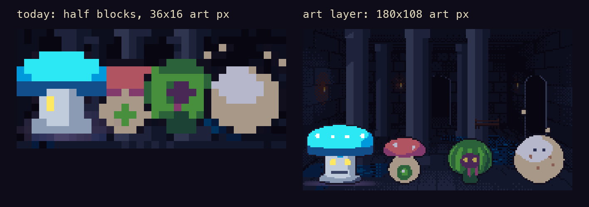
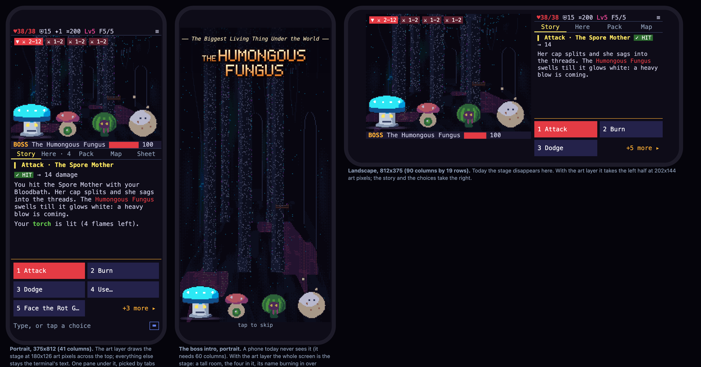

# A real phone view: modular windows, an art layer, and the app around them

Design only: no game code changed. Written 30 Oct 2026 against `v2` at 6a92864. It builds on
[cross-platform-and-mobile.md](cross-platform-and-mobile.md) (23 Oct): that plan's Phase 2 and Phase 3 are built (`ptg
serve`, the name page, touch input, browser sound), but its narrow layout isn't, and the phone app is still a sketch.
Pictures for this plan are in [`mobile-view/`](mobile-view/), including a mockup page you can open in a browser
(`mockup.html`, served from `docs/` by the `maker` launch config).

## Bottom line

- **The density worry is right, and it's about the pictures, not the text.** At a readable font a phone gets about
  41 columns. Text is fine at 41 columns. Pictures aren't: a terminal cell holds two pixels of art, so the stage gets
  36x16 art pixels, a fight with four foes gives each about 9 pixels across, and the boss clips (made at 84 pixels)
  can't play at all. In landscape the stage disappears. The boss intro and its subtitle never show on a phone.
- **The fix is an art layer, not a smaller font or a native rewrite.** Keep the terminal for everything it's good at
  (text, boxes, buttons, the look), and draw the pictures as real images on top of the cells they'd have filled, where
  the client can: the browser page, and the phone app (which is the same page). The game already draws every frame as
  an image before turning it into half blocks; the art layer sends the image instead. In the same space, the stage
  goes from 36x16 to 180x108 art pixels, and it costs about the same to send (measured below).
- **Make every window a component with a size contract,** then lay those components out per size tier: phone portrait
  (under 60 columns), compact (phone landscape and small windows, under 28 rows), and full (today's screens). Phones
  get a new `PhoneScreen` arrangement of the same parts, not a fourth hand-made layout.
- **No terminal emulator to write.** xterm.js already is the terminal emulator, and the served page already uses it.
  The app is a native shell around that page (a web view), with the game's Python running inside the app: CPython now
  ships official iOS and Android builds, and Briefcase or Flet bundle it. Two things need a spike first: a small
  in-process display driver (phones allow no subprocess), and phone builds of pydantic-core (none on PyPI; Flet's index
  has them if pydantic is pinned back). See section 5.
- **Order:** the modular windows and the phone layout first (they work in the browser today, with half-block art),
  then the art layer in the served page, then the app shell, then the on-device narrator. Each step is playable on its
  own, and nothing is thrown away.

## 1. What a phone gets today (measured)

Served game, Chrome's phone emulation (375x812, touch, 2x), `PTG_TOUCH=1`; and `make_plan` on the same sizes.

| | Portrait, 375x812 | Landscape, 812x375 |
| --- | --- | --- |
| Terminal | 41 columns (15 px font) by about 44 rows | 90 columns by 19 rows |
| Screen | classic `GameScreen`, one column, compact (touch always picks it) | classic, two columns, compact |
| Stage | 36x8 cells = **36x16 art pixels**; a fight's foes halved, no clips (they need 9-12 rows) | **none** (a stage needs 25 rows at 90 columns) |
| Boss intro | never (it needs 68x24) | never |
| Here | chips only (a mini card needs 12 rows, the strip has 8) | 7 rows |
| Choices | one-row chips | one-row chips |

Panels and screens at 41 columns: the title (68 columns) and its four-button menu (64) overflow; the campfire's two
columns leave its cards about 4 columns wide; the Bestiary's list is a fixed 28 columns and leaves 7 for the entry; the
Pack's and Shop's detail columns are 11 wide; the floor card's splash needs 32 columns and gets 31. Touch enlarges only
the ways bar and Here's buttons: choices, menu and pick rows and the D-pad stay one row tall, under a thumb's 44 points.

## 2. The art layer

### What it is

A picture in the game (the stage, the boss intro, the d20, an item's turning model, a portrait, a floor's splash) is
already drawn by Pillow as an image and then turned into half-block text (`sprites.image_text`). On a client that can
draw images, it would send the image instead:

1. **Game side:** an `Art` widget. In a terminal it draws half blocks, as now. On the web it reserves its cells (blank,
   in the picture's average colour) and sends each frame over the side channel the browser sound already uses
   (`write_meta` → `serve.py`'s `on_meta` → the page): `{"type": "ptg_art", "id", "region": [x, y, w, h] in cells,
   "png": ...}`, plus `move` on relayout and `hide` when a screen covers it or it unmounts.
2. **Page side:** a canvas per art id, positioned over those cells (the page knows xterm's cell size), drawing the PNG
   with `image-rendering: pixelated`, under any modal the game puts over it (the game says when). About 150-250 lines
   of JavaScript next to the sound player.
3. **Resolution:** the game draws the picture at the pixel size the client asks for (the page sends its device pixel
   ratio and the art scale it wants, as it sends `PTG_TOUCH` now). On a 375-pixel phone at 2 CSS pixels an art pixel,
   the portrait stage is 180x126 art pixels; `encounter.Fight` and `room_picture.Picture` already draw at any size, so
   the 64- and 84-pixel clips become usable on a phone.

Text over pictures (a foe's next move, the banner, health) stays terminal text: crisp, the game's font, readable.

### What it costs (measured)

| | Half-block text a frame | As an image (PNG) |
| --- | --- | --- |
| Phone stage today, 36x8 cells (36x16 art px) | 5.2 KB of terminal codes | 0.9 KB |
| Phone stage with the art layer, 180x108 art px | (impossible) | 5.9 KB, 0.5 ms to encode |
| Desktop browser stage, 200x30 cells | 47.5 KB | about 8 KB |

Making the half blocks takes 2.3 ms a frame at 180x108, more than encoding the PNG. At 24 frames a second the phone
stage is about 140 KB/s while something moves, nothing while it doesn't: fine on Wi-Fi and 4G, and free inside an app.
Later, idle loops can be sent once as clip strips for the page to play itself (the way it caches sounds).

### Which pictures, in order

1. **The stage:** rooms, fights, clips, blows' numbers, shatter, wipes.
2. **The boss intro:** full screen on a phone, portrait or landscape, with the subtitle lettering as pixels.
3. **The d20** in the dice screen.
4. **Item models** (found cards, pack and shop details) and the hero portrait.
5. **Floor splash art** and Here's tiles (tiles live in scrolling lists: last, because the page must follow the scroll).

### Things to design carefully

- **Covering and scrolling.** Textual decides what's on top; the page can't see it. The game must tell the page when an
  art view is covered (the dice box over the stage), moved (relayout, resize, a fold) or scrolled. Fixed-position art
  first; scrolling art (tiles) last.
- **Portrait crowds.** Four foes side by side in 180 pixels get about 45 each, so they shrink to the 40-pixel clips
  (visible in the mockup). Portrait wants a different arrangement: the boss big at the back and its party smaller in
  front, or the faced foe big with the others as a strip. That's `encounter.Fight`'s placement, by the stage's shape.
- **Desktop terminals.** They keep half blocks: that look is the game's. Terminals with the Kitty graphics protocol
  (Ghostty, Kitty, WezTerm) could take the same `Art` widget later, as an option; see section 5.

## 3. Modular windows

Each part of the screen becomes a component that takes a box (columns x rows) and a size tier, and draws itself to fit
or says it can't. `ui/plan.py` already does this for the classic screen's geometry; this generalises it.

| Tier | When | Example |
| --- | --- | --- |
| phone | under 60 columns | 41x44 portrait |
| compact | 60 columns or more, under 28 rows | 90x19 landscape, a small laptop window |
| full | the rest | today's grid (110x32+), tabs, classic |

Textual's size classes already exist (`-narrow`, `-tiny`, `-short`, `-tall` in `app.py`, set from `widgets.py`); the
tiers are named on top of them.

| Component | Phone portrait | Compact | Notes |
| --- | --- | --- | --- |
| Status bar | one row, short form (`#hud-short`) | one row | as now |
| Stage (art) | full width, about a third of the height | left half | needs the art layer to be worth it |
| Banner | one row of text under the stage | one row | |
| Story | one pane under tabs | right column | the default pane while you play |
| Here | one pane under tabs: tiles in one column | a pane | tiles as art later |
| Choices | big buttons, two across, two rows tall | two across | the main way to play by thumb |
| Command line | behind a keyboard button | one row | typing stays possible |
| Map | a pane under tabs (the plain chart) | a pane | parchment on tablets |
| Panels | full-screen sheets: a title bar with ◂ back, one column | sheets | list, then detail (Bestiary, Pack, Shop) |
| Dice | full screen: the d20 as art, the verdict under it | the die left, words right | today's box overflows 18 rows |
| Boss intro | full screen | full screen | today needs 68x24 |
| Title, campfire | the name small, the menu stacked; cards one column | | today overflow at 41 |

Touch rules for every component: anything tappable is at least two rows tall (about 40 px at the phone font, close to
Apple's 44 points) and four columns wide; hover hints become tap-for-hint; no hidden F-keys (the tabs and ☰ replace
the footer).

## 4. The phone layout

**Portrait (375x812, 41 columns by about 44 rows):**

| Rows | What |
| --- | --- |
| 1 | status: HP, defence, fate, gold, level, floor, ☰ |
| 14 | the stage (art layer): 180x126 art pixels; a foe's next move over its head |
| 1 | banner: name, danger, health |
| 2 | tabs: Story · Here · Pack · Map · Sheet |
| about 16 | the pane the tabs pick (the story while you play; it follows the newest lines) |
| 7 | choices: big buttons two across, "+N more ▸" |
| 2 | "Type, or tap a choice" and the keyboard button |

**Landscape (812x375, 90 columns by 19 rows):** the stage on the left (45 columns: 202x144 art pixels) with its
banner; on the right the status, the tabs, the pane and the choices two across.

**Everything else** is a full-screen sheet (Pack, Sheet, Bestiary, Journal, Help, Shop, level-up, found cards), a
title bar with ◂ back on top, one column, list then detail, the picture (model, portrait, sprite) big at the top of a
detail through the art layer. The dice and the boss intro take the whole screen.

**Folding phones** (the Z Fold 8 test device): the cover screen is phone portrait, the inner screen is tablet-sized
(full tier, or compact in landscape). A fold is a resize: every component re-lays itself out, and the art layer
re-sends at the new size.

## 5. The app around it

Checked 30 Oct 2026 (sources linked; "unconfirmed" where they couldn't be confirmed).

**No terminal emulator to write.** xterm.js is the emulator, and the served page already runs it. An app is a native
shell with a web view showing that same page: xterm.js, the art layer's canvases, Web Audio. What's left to decide is
where the game's Python runs.

| Where Python runs | How | For | Against |
| --- | --- | --- | --- |
| **On the phone, embedded CPython** (recommended) | python.org's official packages: [Android](https://www.python.org/downloads/android/) since 3.14, [iOS](https://www.python.org/downloads/ios/) since 3.15 (out 9 Oct 2026), through [Briefcase](https://briefcase.readthedocs.io/) 0.4.7 / Toga 0.5.7 or [Flet](https://flet.dev/) 1.0 | Real CPython: threads, full speed, the game unchanged. Offline. The on-device narrator needs it anyway | The display needs an in-process driver (below); some compiled packages lack phone builds (below) |
| On the phone, Pyodide in the web view | [textual-wasm](https://kaierikniermann.github.io/textual-wasm/) 0.2.1 | Little native code | Alpha, one maintainer, untested on phones; no threads; boot takes seconds; iOS gives WebAssembly about 300 MB and kills the page past it ([WebKit 269777](https://bugs.webkit.org/show_bug.cgi?id=269777); today's limit unconfirmed) |
| On a server (Render), the app a web view of it | what testers use now | Nothing new to build | Needs a network; no on-device narrator; App Store 4.2 rejects apps that are "a repackaged website" |

**The in-process driver.** Phones forbid subprocesses (iOS outright), so textual-serve's process per player can't run
in an app. Textual has a public driver hook (`TEXTUAL_DRIVER=module:Symbol`), and textual-wasm's `WasmDriverBase` is a
template for a driver that writes to xterm.js. The page talks to it over a WebSocket on localhost inside the app, with
the protocol it uses now: aiohttp has iOS and Android builds since 3.14. (Toga's web view has no JavaScript-to-Python
channel of its own, so the localhost socket is the simplest route; native message handlers are the other.) Nobody has
shipped Textual inside a phone app that I could find, so this is the thing to spike.

**Compiled packages on phones** (PyPI, 30 Oct 2026):

| Package | iOS | Android | Way through |
| --- | --- | --- | --- |
| pydantic-core (pydantic v2's engine) | no | no | [pydantic#12739](https://github.com/pydantic/pydantic/issues/12739) is open. [Flet's index](https://pypi.flet.dev/pydantic-core/) has 2.46.4 for both, which means pinning pydantic to 2.13.4 (the game is on 2.14.1); or build it with maturin (PyO3 supports iOS) |
| Pillow | yes (13.0.0) | no | Flet's index has 12.3.0 for Android; the game pins `pillow>=13`, which would relax |
| aiohttp | yes | yes | |
| multidict, yarl, frozenlist, propcache | some | some | pure-Python fallbacks work |

**Which shell.** Briefcase and Flet both bundle CPython for iOS and Android and both have a web view. Flet also
maintains the phone builds of pydantic-core and Pillow, which is the main blocker; Briefcase is plainer Python. The
spike should try Flet first and Briefcase second. Not Capacitor (no Python plugin: we'd embed CPython ourselves in Swift
and Kotlin) and not Tauri (no sidecar processes on phones, and its Python plugins list iOS "with caveats").

**App Store and Play rules.** Apple's 2.5.2 allows an interpreter and scripts shipped inside the app (Pythonista and
Briefcase apps ship this way), but not new code downloaded later: new story and features come as app updates. 4.2
wants more than a repackaged website; an offline game with an on-device narrator clears that. Accounts: $99 a year
(Apple), $25 once (Google).

**The phone's own narrator, from Python.** Apple's Foundation Models is Swift-only: a small `@objc` Swift class with
completion handlers, called through rubicon-objc, or the C API Apple's own `apple-fm-sdk` wraps it in (macOS-only and
alpha today). Gemini Nano's ML Kit GenAI Prompt API (`genai-prompt` 1.0.0-beta5) has a Java API that Chaquopy (under
Briefcase's and Flet's Android builds) can call. Details and limits in
[cross-platform-and-mobile.md](cross-platform-and-mobile.md) §4.

**Images in desktop terminals, for later.** The same `Art` widget could draw real images in desktop terminals with the
Kitty graphics protocol (Kitty, Ghostty, iTerm2) through [textual-image](https://github.com/lnqs/textual-image) 0.14.2,
which covers Textual 8. It has no animation API and flickers when frames change, Ghostty has no Sixel, and
Terminal.app has neither, so half blocks stay the desktop default. In the browser the page's own canvas beats
xterm.js's image addon (Sixel and iTerm images are beta there, and don't animate).

**Effort:** a spike of 3-5 days on the Fold 8 (an APK: the shell, CPython, the in-process driver, the page, one fight
at 24 frames a second with the art layer, memory and battery), then the iPhone. If it holds: about 1-2 weeks a platform
for the app, and a week for store preparation (icons, privacy manifests, review).

## 6. Plan

| Phase | What | Effort | Gets you |
| --- | --- | --- | --- |
| A | Modular components with size contracts; `PhoneScreen` (portrait and compact); one-column panels and sheets; narrow title and campfire; touch-size targets | 1.5-2 weeks | A good phone layout in the browser today, half-block art |
| B | The art layer in the served page: the `Art` widget, the side channel, the page's canvases; stage, boss intro, d20, models | 1-1.5 weeks | The pictures at five times the detail on phones, and lighter on desktop browsers |
| C | The app: a spike on the Fold 8 first (shell, embedded CPython, the in-process driver, the page), then iPhone; then the stores (section 5) | spike 3-5 days; 1-2 weeks a platform; a week for the stores | An offline app on both stores |
| D | The on-device narrator ([cross-platform-and-mobile.md](cross-platform-and-mobile.md) §4) | 3-5 days a platform, on top of C | Free, offline narration |

A and B are worth doing before any app, and they help the Render testers now. Real-device checks after each: an iPhone
(Safari) and the Fold 8 (Chrome; cover, inner, folding).

### Started: the existing windows made phone-ready (30 Oct)

JT: "fix up the existing modules (windows) to be better at being responsive" first. A `-phone` size class (under 60
columns, `widgets.PHONE`) joins `-narrow` and `-wide`, and these windows now fit a 41x44 phone held upright or a
90x19 one on its side (`tests/test_phone.py`; before and after in
[`mobile-view/phone-windows-before-after.png`](mobile-view/phone-windows-before-after.png) and
[`dice-sideways-before-after.png`](mobile-view/dice-sideways-before-after.png)):

- **Title:** the name's three words stacked when it won't fit in a line; the menu two by two; the lines under it wrap.
- **Campfire:** one column, the fire and the way down on top, the blessing cards two across; the Title button gives way
  on short screens too (Esc still goes there).
- **Dice:** on a short, wide screen the die on the left and the words beside it (it ran off the bottom at 18 rows).
- **Pack and Shop:** the shelf one row of tiles across the top that scrolls sideways, the picked thing full width
  under it (it had 11 columns); no shopkeeper column.
- **Bestiary:** the list over the creature; an empty bestiary hides its empty list at every size.
- **Menu and pickers:** played with a finger, every panel gets the `touch` class: rows three tall, the box scrolling
  where they don't all fit.
- **Character sheet:** under 48 inner columns each roll's sources go on a line of their own.
- **Floor card and Look:** their pictures are drawn down to 28 and 30 columns (a phone upright has 31 and 33).

### The phone spike (30 Oct, evening)

JT, after playing it on the Fold 8 unfolded ("very playable"): the real phone view from the mockup, the A− A+ buttons
gone (they reloaded the page, and the game with it), nothing hopping about, and tapping a boss (in every layout) or a
bestiary entry to see its animations big. Built:

- **`PhoneScreen`** (`ui/phone.py`), what a touch screen plays on: every box a fixed size, set by the screen's size
  alone, so a fight starting, a full room or a long choice never moves another box. Upright (under 60 columns): the
  status bar, the stage, the tabs (Story, Here, Pack, Map, Sheet, two rows tall), their one pane, the ways out, the
  choices as big buttons two across (every one, Here's own first, so Attack is button 1), the command line. Wide (the
  Fold opened out, a phone on its side): the stage and the story on the left, the tabs, the ways and the buttons on the
  right. Turned or folded across the line, it's laid out again, mid-fight too. The ☰ menu's Layout swaps the classic
  screen in, to compare.
- **The art layer** (`ui/art_layer.py`, the page's `window.ptgArt`): on the web the stage's room and fight go to the
  page as PNGs at four art pixels a cell, drawn on a canvas over their cells; the fight's banner stays words under the
  picture and the foes' next moves are chips over it. Rooms and the fight's copy at those pixels are drawn off the
  screen's thread. A fight's moments (blows, falls, wipes, spoils) still play in half blocks, the picture stepping
  aside for them; anything put over the game (dice, panels, the viewer) hides it.
- **The creature viewer** (`ui/creature.py`): tap the stage in a fight (any layout), a creature in a tabs or phone
  frame, or a bestiary picture: its own clips play in turn (entrance, idle, attack, windup) at the biggest size the
  screen has room for, cropped to the columns they use; a creature without clips stands in its poses. On the web, at
  its own pixels.

Next: the fight's moments in the art layer too (the swing, the shatter, the entrance, the spoils), and the boss intro
on a phone through it (today it needs 68x24); Here's and the Pack's frames as art; portrait crowds (the boss at the
back, its party in front); real-device checks on an iPhone and the Fold 8.

## Pictures (`mobile-view/`)

- `phone-stage-today-vs-art-layer.png`: the Spore Bed fight on a 375-pixel phone, today's half blocks against the art
  layer in the same space.
- `mockup.png`, from `mockup.html`: portrait fight, portrait boss intro, landscape fight, at a 375x812 phone's size.
- `art-stage-portrait.png`, `art-stage-landscape.png`, `art-intro-portrait.png`: the art the mockups use, at the
  stage's own pixels, drawn by the game's own code (`encounter.Fight`, `boss_title`).
